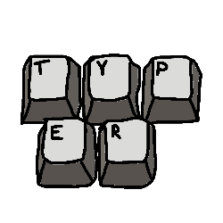
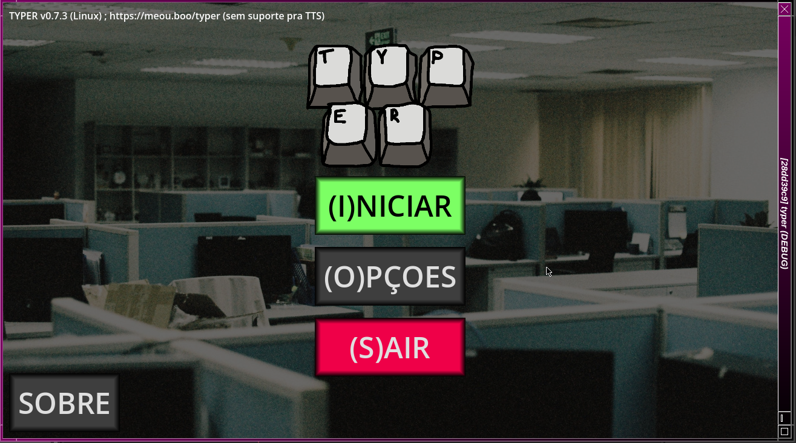
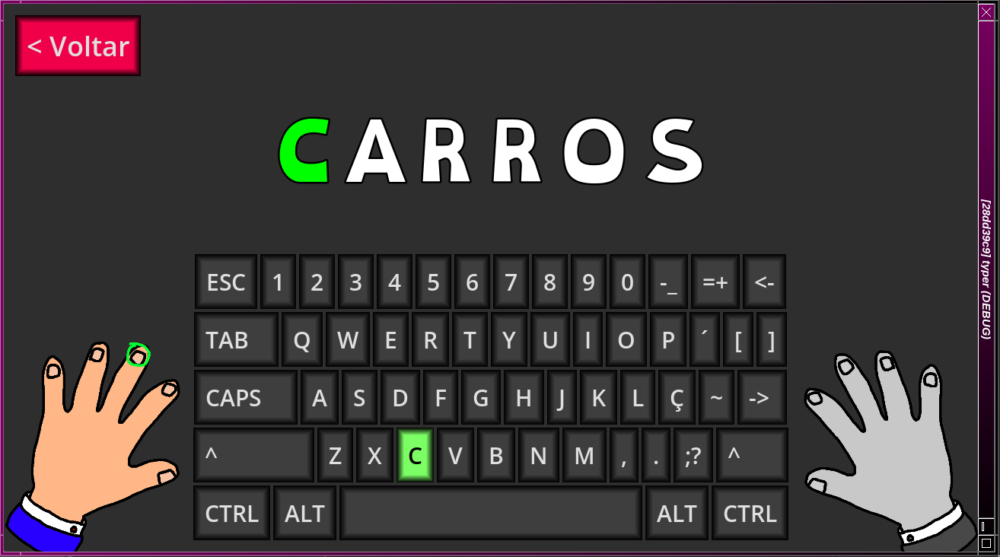

# Typer

Typer is available in [Codeberg](https://codeberg.org/rafameou/typer) as the main repository and in [GitHub](https://github.com/rafameou/typer) as a mirror.

You can play it right now (clicking here)[https://meou.boo/typer]!

## Introduction 

Typer is an educational game aimed at learning to type, with the idea of using your hands and fingers correctly. 

The game was created using Godot 4.7 for a university project and tested on people with intellectual disabilities. 

The idea is to bring a more educational and childish approach, different from a serious game or application considered as a "Typing Courses" like Klavaro (https://klavaro.sourceforge.io/en/index.html).

The logo and graphics were all drawn by me, using GIMP with the default brush tool. Currently the main menu background is "stolen" from unsplash.

## Huge thanks to

- My teacher Simone Nasser for helping me with software ideas and connecting me with schools to test the game.
- @JKoleski (on GitHub) for helping me test the program and with ideas.
- @lucthesloth (on GitHub) for showing me the "LineEdit" function in Godot that accepts accents.

## Contributions and code analysis

Usage of generative ai is strictly forbidden, even for code analysis or debugging. This is a hobby project, created for fun.